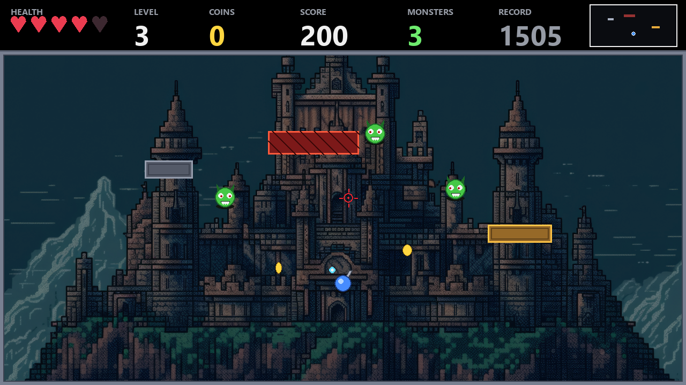

# Monster Rampage

**A castle-themed top-down arena shooter** made with Python and Pygame CE. Fight through escalating monster waves, collect coins, and survive long enough to set a new record.



## Features

- A dark castle arena with hazards, obstacles, coins, and increasingly difficult levels.
- Mouse aiming with a red in-game crosshair, plus **IJKL** keyboard aiming as a laptop-friendly fallback.
- Shuffled menu and gameplay music, event-based sound effects, and a saved master-volume slider.
- A browser edition that runs locally in Chrome.
- A one-file Windows build can be generated from the included source.
- Local high scores and settings stored in `savegame.json`.

## Controls

| Action | Controls |
| --- | --- |
| Move | `WASD` or arrow keys |
| Aim | Mouse or `IJKL` |
| Shoot | Left mouse button or `Space` |
| Pause / resume | `Esc` |

## Run the desktop game

On Windows, install Python 3.14, then run these commands from the project folder:

```powershell
py -3.14 -m venv .venv
.\.venv\Scripts\python.exe -m pip install -r requirements.txt
.\.venv\Scripts\python.exe game.py
```

## Build a standalone Windows EXE

With the environment above installed, run:

```powershell
$castle = (Resolve-Path castle.jpg).Path
$sounds = (Resolve-Path 'sound effects').Path
$castleData = "$castle;."
$soundData = "$sounds;sound effects"
& .\.venv\Scripts\python.exe -m PyInstaller --noconfirm --clean --onefile --windowed --name MonsterShooter --add-data $castleData --add-data $soundData --distpath release --workpath .build\pyinstaller --specpath .build game.py
```

The executable is created at `release\MonsterShooter.exe`. The image, music, and sound effects are bundled into it. The `release` folder is ignored by Git so build output does not clutter the source history.

## Play in Chrome

The browser edition is served from this computer. Start the local server with:

```powershell
.\run_in_chrome.ps1
```

Then open [http://localhost:8000](http://localhost:8000). Keep the PowerShell window open while playing. To let a friend try it over the internet, start a Cloudflare Quick Tunnel in a second terminal:

```powershell
cloudflared tunnel --url http://127.0.0.1:8000
```

Share the temporary `trycloudflare.com` address printed by the command. Anyone with that address can access the game while both the local server and tunnel are running. Stop the tunnel with `Ctrl+C`.

## Audio assets

Put the audio files in the existing folders under `sound effects/`:

- `menu/` — shuffled menu music.
- `in game/` — shuffled gameplay music.
- `effects/` — `coin`, `laser_player`, `losing`, `monster_dying`, `new_record`, and `player_hit` effects.

The master-volume slider in Settings adjusts music and effects together. Local records and volume preferences are saved beside the desktop game and are not committed to the repository.

## Project layout

```text
game.py                  Pygame desktop game
castle.jpg               Arena background
sound effects/           Music playlists and sound effects
.web-site/               Browser edition (HTML, JavaScript, and assets)
docs/gameplay.png        README gameplay image
run_in_chrome.ps1        Local browser-game server
requirements.txt         Python dependencies
```

## Български

**Monster Rampage** е 2D top-down shooter в замък. Управлявай героя с `WASD` или стрелките, прицелвай с мишката или `IJKL` и стреляй с левия бутон или `Space`. Настрой звука от Settings. Играта включва версия за Chrome и Windows EXE, който се компилира от изходния код с командата по-горе.
